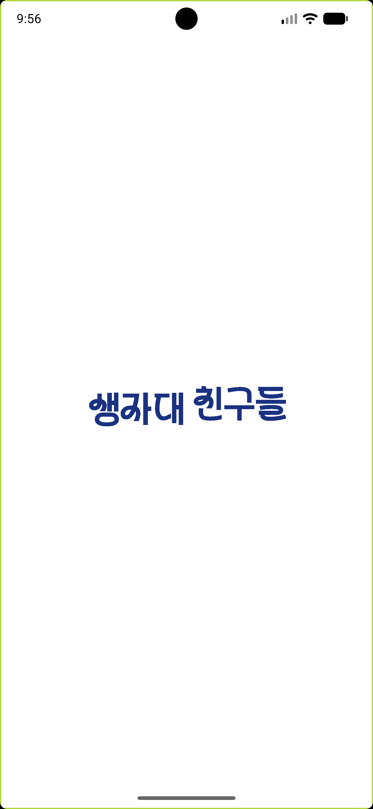
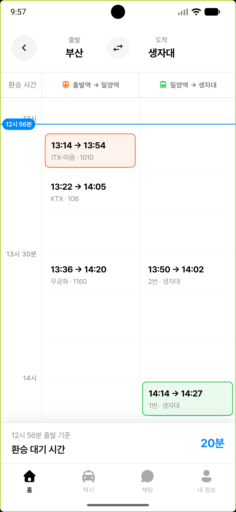
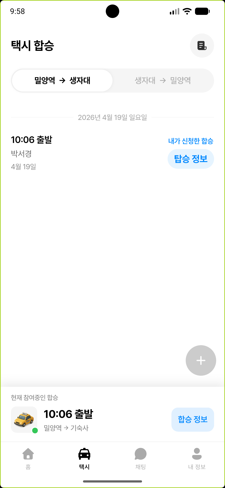
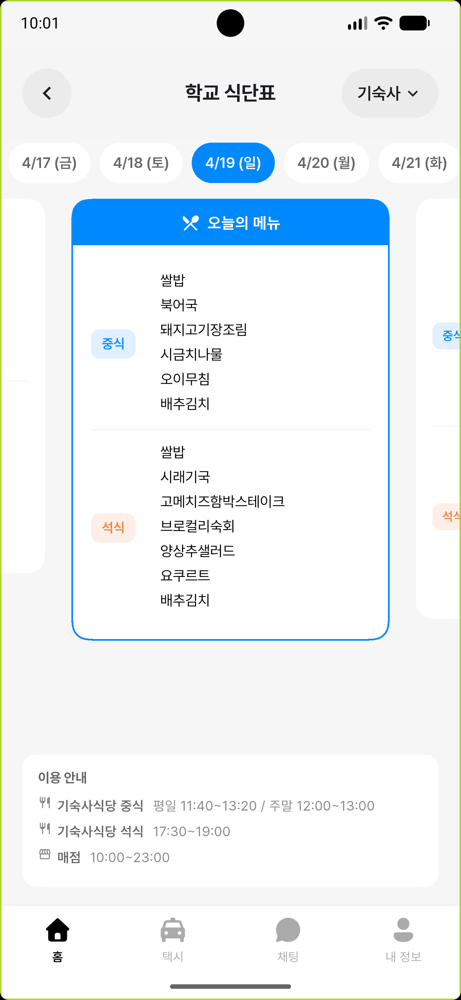

<section class="hero project-hero">

PROJECT 05
<h1 class="title is-1 publication-title">Campus Mobility, Ride-Sharing and Dining App Development</h1>
<a href="/">Seokyung Park</a>

Cross-platform mobile application · Flutter and Supabase

</section>

I designed and developed a **cross-platform mobile application for students at Pusan National University's Miryang Campus**. The app, released under the name *Sangjadae Friends*, brings together daily transport and campus-life tasks that were previously split across timetables, notices and separate messaging channels.

The work covered **mobile interface design, application architecture, backend integration and data collection**. The Flutter client uses Riverpod, GoRouter and Freezed, while Supabase provides PostgreSQL, authentication, real-time messaging, storage and Edge Functions. Python crawlers collect and structure campus dining information.

<figure><figcaption>Home screen and service entry points</figcaption></figure>
<figure><figcaption>Train-to-campus-bus transfer planning</figcaption></figure>
<figure><figcaption>Real-time taxi ride-sharing</figcaption></figure>
<figure><figcaption>Campus dining information</figcaption></figure>

## What I built

<article><h3>Integrated transport planning</h3>
Combined train schedules with campus bus times in a single timeline so students can compare transfer options and expected waiting time.
</article>
<article><h3>Real-time taxi ride-sharing</h3>
Implemented ride creation and participation flows, capacity controls, role-based actions, live chat and fare-settlement information for trips between Miryang Station and campus.
</article>
<article><h3>Campus information</h3>
Added bus timetables and structured dining menus for dormitory, student and staff restaurants, supported by automated data collection.
</article>
<article><h3>Full-stack mobile architecture</h3>
Built the Flutter application and connected authentication, PostgreSQL data, real-time updates, storage and server-side functions through Supabase.
</article>

## Engineering scope

- **Frontend:** Flutter, Riverpod, GoRouter and Freezed for cross-platform UI, navigation and state management.
- **Backend:** Supabase PostgreSQL, Auth, Realtime, Storage and Edge Functions.
- **Data pipeline:** Python, Playwright and BeautifulSoup for collecting campus information.
- **Product concerns:** input validation, loading and retry states, access control, concurrency-safe ride capacity, sensitive-data masking and responsive layouts.

This project gave me practical experience taking a student-facing mobile service from feature requirements and screen design through **full-stack implementation and device-level testing**.

<a href="/">← Back to home</a><a href="#top">Back to top ↑</a>

